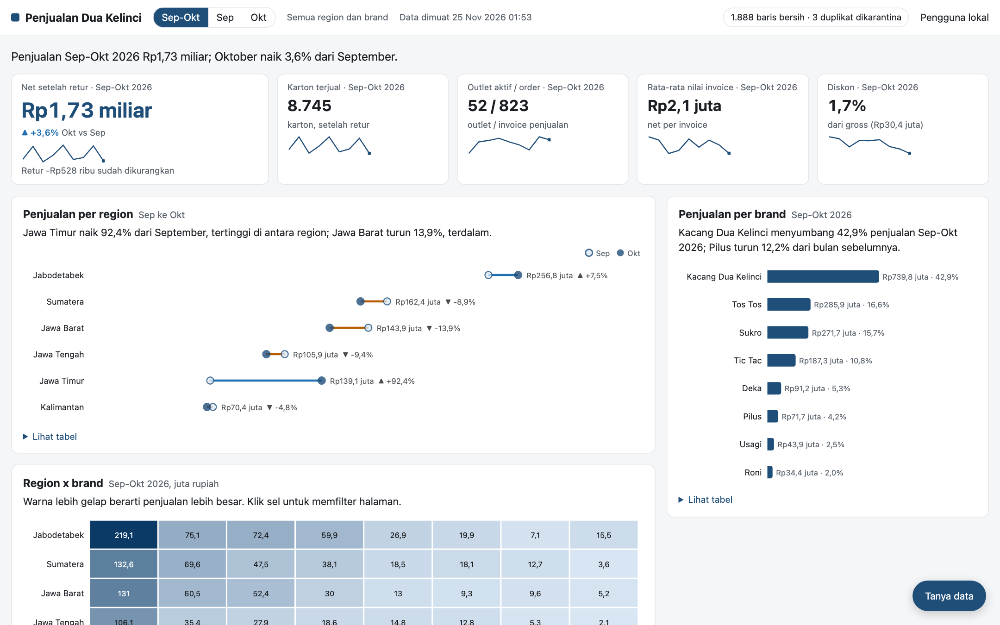
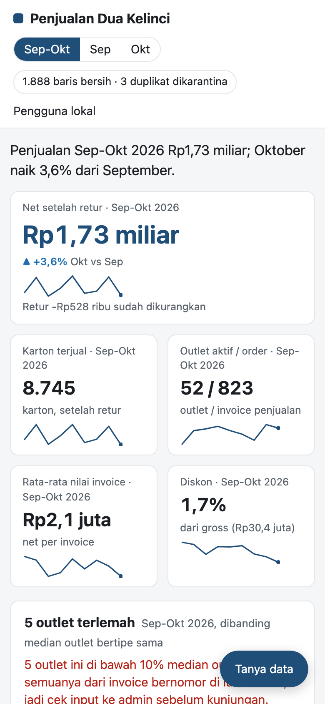
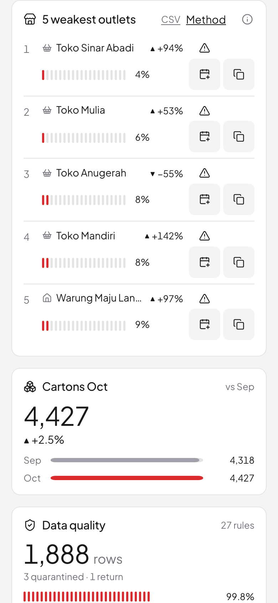
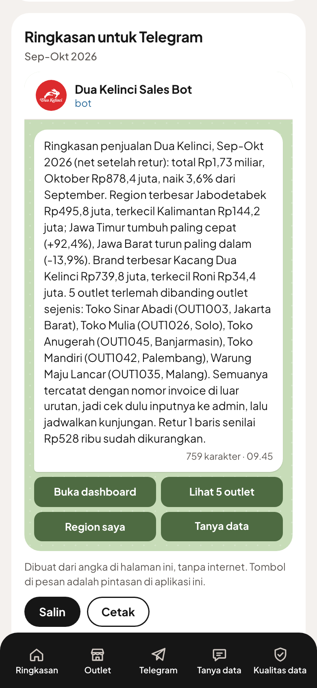

# Penjualan Dua Kelinci

[](https://github.com/baguskto/dua-kelinci-sales-insight/actions/workflows/ci.yml)

Dashboard satu layar untuk Commercial Director dan Head of Sales: berapa penjualan berubah bulan ini, apakah perubahannya nyata (per hari kerja dan tanpa outlet penyumbang terbesar), dari region dan brand mana, 5 outlet terlemah dibanding outlet sejenis, dan satu paragraf ringkasan yang siap dikirim ke Telegram. Data mentah dibersihkan dengan 27 aturan kualitas data yang bisa diperiksa, dan ada "Ask the data" yang menjawab hanya dari angka di file. Tampilan berbahasa Inggris; dokumen berbahasa Indonesia.



  

## Menjalankan (Python 3.11 atau lebih baru, macOS atau Windows)

```
pip install -r requirements.txt
python app.py
```

Buka http://127.0.0.1:8000. Tidak perlu akun, kunci API, atau internet setelah instalasi. Data default adalah `sales.csv` di folder ini (sama persis dengan file contoh). File lain (.csv atau .xlsx) bisa diunggah dari panel Data quality.

Dengan [uv](https://docs.astral.sh/uv/): `uv run app.py`. Dengan Docker: `docker compose up` lalu buka http://127.0.0.1:8000.

Start pertama sekitar 12 detik karena Python mengompilasi library sekali; start berikutnya sekitar 2 detik.

## Yang perlu diketahui

- Angka utama adalah penjualan neto setelah retur. 3 baris duplikat persis dikeluarkan ke karantina, 1 retur dikurangkan, region dan nama outlet dibakukan. Total mentah ke bersih selisih 0 rupiah.
- Outlet terlemah = penjualan outlet dibagi median outlet bertipe sama, jadi Warung dibandingkan dengan Warung. Lima outlet terlemah (OUT1003, OUT1026, OUT1045, OUT1042, OUT1035) hanya muncul di blok invoice bernomor di luar urutan. Mereka tetap dihitung dan diberi ikon catatan data. OUT1001 dan OUT1003 bernama sama di cabang yang sama; keduanya tetap dihitung terpisah dengan catatan kemungkinan data master ganda.
- Cerita bulan ini dihitung dari data, bukan ditulis tangan: Oktober naik 3.6%, tapi per hari kerja turun 0.2% dan tanpa Grosir Lancar Jaya (+Rp 47.7M) turun 2.0%; 4 dari 6 region turun. Jembatan per region selalu berjumlah sama dengan perubahan total (dites). Penjelasan: [docs/11-ceo-view.md](docs/11-ceo-view.md).
- Ringkasan Telegram (bahasa Inggris, sekitar 400 karakter, mulai dari insight) dibangun dari angka yang sudah dihitung, jadi jalan offline. Kirim ke Telegram dan perapian bahasa dengan Claude hanya aktif bila diatur lewat `.env` (lihat `.env.example`); setiap angka hasil AI dicek dulu.
- Setiap outlet terlemah punya dua tombol ikon yang jalan tanpa server tambahan: kalender mengunduh file .ics untuk hari kerja berikutnya, salin menyalin teks tugas untuk salesman.
- Semua grafik adalah SVG dari server (tanpa library chart). Arah desain: [DESIGN.md](DESIGN.md); hasil Delivery Gate antislop: [docs/11-ceo-view-antislop-gate.md](docs/11-ceo-view-antislop-gate.md).
- "Ask the data" bekerja offline dengan aturan dan template, dengan pertanyaan dan jawaban bahasa Indonesia. Bila `ANTHROPIC_API_KEY` diisi, Claude menjawab lewat tool baca-saja, dan jawaban yang angkanya tidak cocok diganti jawaban template.

## Dokumen

- [Audit kualitas data](docs/01-dq-audit.md), [profil data mentah](docs/01-profiling.md), [rekonsiliasi](docs/02-reconciliation.md), [kamus data](docs/02-data-dictionary.md), [kontrak data](docs/02-data-contract.md)
- [Definisi angka dan outlet terlemah](docs/06-metric-definitions.md)
- [Konsep UI](docs/05-ui-concept.md) dan [arsitektur](docs/07-architecture.md)
- [Guardrail chat dan ringkasan](docs/08-guardrails.md)
- [Yang akan saya bangun berikutnya](docs/09-next-steps.md)
- Laporan: [fase 1](docs/03-phase1-report.md), [fase 2](docs/04-phase2-report.md), [desain ulang](docs/10-redesign-report.md), [tampilan CEO](docs/11-ceo-view.md)

## Untuk developer

```
uv sync --all-extras          # dependensi runtime, dev, llm, oidc, observability
uv run pytest                 # unit, integrasi, e2e (Playwright: uv run playwright install chromium)
make data                     # bangun ulang data/processed dan dokumen fase 1 dari data/raw
uv run python scripts/live_eval.py   # set golden dan red-team chat (offline)
uv run python scripts/ui_screenshots.py   # perbarui screenshot di docs/img
```

## Production

Mode production (login Microsoft Entra ID atau akun lokal, TLS, metrik, log, alert, tracing) dijelaskan di [docs/ops](docs/ops/README.md) dan [docs/security](docs/security/README.md). Laporkan masalah keamanan sesuai [SECURITY.md](SECURITY.md).

## Merek dan huruf

Logo dan nama Dua Kelinci milik PT Dua Kelinci, dipakai hanya untuk keperluan tes rekrutmen. Huruf Plus Jakarta Sans disimpan lokal di `src/dk_sales/web/static/fonts/` dengan lisensi SIL Open Font License (`OFL.txt`). Ikon Lucide (lisensi ISC) disimpan di `static/vendor/lucide/`, garis pantai peta dari Natural Earth (domain publik). Aplikasi tidak memuat apa pun dari CDN.
