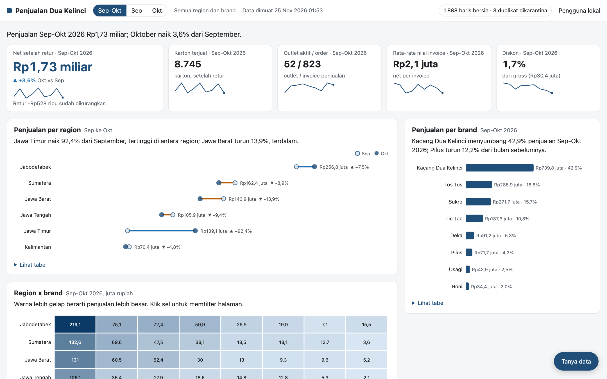
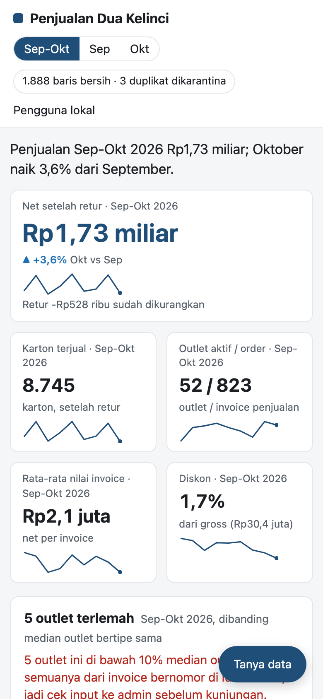

# 10 Laporan desain ulang dashboard (DK-3)

Tanggal: 25 November 2026. Repo: https://github.com/baguskto/dua-kelinci-sales-insight (branch `main`).

Bagus menilai grafik versi pertama terlalu biasa dan memilih gabungan moodboard A + E + G, dengan dumbbell dari B. Dashboard sekarang memakai brand Dua Kelinci (putih, merah `#DC2B2D`, hitam `#161616` untuk teks dan rail, netral hangat sebagai tint), huruf Plus Jakarta Sans yang disimpan lokal, dan logo Dua Kelinci. Konsep lengkap, arti warna, dan alasan memilih atau membuang setiap papan ada di [docs/05-ui-concept.md](05-ui-concept.md).

## Sebelum dan sesudah

| Sebelum | Sesudah |
|---|---|
|  |  |
|  |  |

Screenshot lain (semua dibuat ulang dengan `uv run python scripts/ui_screenshots.py`, tanpa Docker):

| | |
|---|---|
| Desktop halaman penuh | `docs/img/dashboard-desktop-full.png` |
| Sapaan per peran, login Head of Region Jawa Barat (akun lokal) | `docs/img/dashboard-head-of-region.png` |
| Ponsel halaman penuh, kartu outlet, pratinjau Telegram | `docs/img/dashboard-mobile-full.png`, `dashboard-mobile-outlet.png`, `dashboard-mobile-telegram.png` |
| Tanya data, Kualitas data, filter Jawa Barat, unggahan rusak | `docs/img/chat-drawer.png`, `data-quality-drawer.png`, `filter-jawa-barat.png`, `upload-error.png` |

## Yang berubah

1. **Rail kiri** hitam dengan logo putih di lingkaran merah dan lima tombol: Ringkasan, Outlet, Telegram (gulir ke bagiannya), Tanya data, Kualitas data (buka laci). Bisa dipakai dengan keyboard, setiap tombol punya label. Di ponsel rail menjadi bar bawah.
2. **Header**: "Selamat pagi, Head of Sales" (pagi, siang, sore, malam menurut jam WIB, peran dari akun yang masuk), atau "Penjualan Dua Kelinci" di mode lokal. Kalimat judul dihitung: "Oktober naik 3,6% · 5 outlet perlu dikunjungi". Pilihan periode Sep / Okt / Sep–Okt dengan pil hitam, pilihan region dan brand, badge kualitas data, dan tepat satu tombol merah ("Kirim ke Telegram" bila Telegram diatur, selain itu "Salin ringkasan").
3. **Kartu KPI**: penjualan neto, karton, outlet aktif (dengan invoice dan rata-rata invoice), diskon. Angka dan satuan dipisah supaya angka tidak pernah terpotong atau menimpa teks.
4. **Grafik utama: kumulatif per tanggal**, September abu vs Oktober merah, label di ujung garis, menggantikan garis yang berisik. Kalimat di atasnya dihitung server. Untuk semua data: "Sampai tanggal 30 Oktober masih Rp6,9 juta di bawah September; tanggal 31, yang tidak ada di September, membuat Oktober menutup bulan Rp30,9 juta di atas September." Ini temuan baru: kenaikan 3,6% Oktober datang dari satu hari tambahan, bukan dari laju harian yang lebih tinggi.
5. **Region**: dumbbell September ke Oktober (papan B), naik hitam dengan ▲, turun merah dengan ▼; daftar region dengan bar (papan E), klik baris untuk memfilter.
6. **Brand**: bar terurut dengan nilai, porsi dan perubahan bulan. Treemap tidak dipakai karena brand kecil tidak terbaca di ponsel.
7. **Alur region ke brand**: sankey papan A dengan pita terang; region dengan perubahan absolut terbesar (Jawa Timur) disorot. Klik nama region, pilih di "Sorot region", atau pasang filter region untuk mengganti sorotan. Tabel region x brand tetap ada.
8. **Panel kanan (papan G)**: pratinjau bot Telegram dengan avatar, jam, jumlah karakter dan empat tombol pintasan (Buka dashboard, Lihat 5 outlet, Region saya, Tanya data); tombol Salin dan Cetak; tombol Kirim hanya bila Telegram diatur. Di bawahnya 5 kartu outlet: peringkat, nama, id, tipe, cabang, bullet bar vs median outlet sejenis, order, nilai bulan terakhir, catatan data, alasan satu baris, saran, dan dua aksi yang jalan offline:
   - "Jadwalkan kunjungan" mengunduh `kunjungan-OUT1003.ics` dari `GET /outlet/{id}/kunjungan.ics` (acara sehari penuh di hari kerja berikutnya, teks di-escape sesuai RFC 5545, baris dilipat di 75 byte, akses mengikuti scope pengguna).
   - "Salin tugas" menyalin teks tugas singkat (outlet, angka, saran, catatan cek data) untuk dikirim ke salesman.
9. **Ponsel 390 px**: kartu merah nilai Oktober dengan sparkline harian, daftar region, kartu outlet, pratinjau Telegram, lalu KPI dan grafik. Tanya data terbuka sebagai lembar layar penuh. Tidak ada gulir horizontal.
10. **Merek**: huruf Plus Jakarta Sans (woff2 variable, subset latin, 27 KB) dan `OFL.txt` di `static/fonts/`, logo di `static/img/`. Footer setiap halaman dan README memuat: "Logo dan nama Dua Kelinci milik PT Dua Kelinci, dipakai hanya untuk keperluan tes rekrutmen."

Yang tetap jalan seperti sebelumnya: start dua perintah tanpa internet, filter dan chip filter, laci Tanya data dengan guardrail, laci Kualitas data dengan unggah, RBAC, CSP ketat tanpa `unsafe-inline`, format angka Indonesia, tabel "Lihat tabel" untuk setiap grafik, fokus keyboard, tampilan cetak.

## Hasil test

| Jenis | Hasil |
|---|---|
| Semua test (`uv run pytest`) | 171 lulus (sebelumnya 151) |
| e2e Playwright | 12 test, termasuk: label ujung grafik kumulatif, sorotan sankey mengikuti pilihan, unduh `.ics` dan isi clipboard "Salin tugas", angka KPI tidak terpotong atau bertumpuk di 390, 1280, 1440 dan 1600 px, urutan dan lebar kartu di ponsel, bar bawah, chat layar penuh, tidak ada error konsol atau pelanggaran CSP |
| Unit baru | data kumulatif dan kalimatnya (5 pola), kalimat header, sapaan per peran dan jam, teks tugas, isi `.ics` (escape, lipat baris, CRLF, tanggal), hari kerja berikutnya, endpoint `.ics` dan scope Head of Region, tepat satu tombol merah, tombol Kirim hanya bila Telegram diatur, huruf dan logo lokal tanpa CDN |
| Cakupan kode `src/dk_sales` | 91% (cabang ikut dihitung; sebelumnya 90%) |
| Lint dan tipe | ruff bersih, ruff format bersih, mypy bersih |
| CI GitHub Actions | test, security dan image hijau untuk push kode desain ulang (run 45534972017) |

Selama pengerjaan, password akun uji di `tests/test_web.py` diganti menjadi acak per run (`secrets.token_urlsafe`) atas permintaan koordinator, supaya repo publik tidak memuat konstanta mirip password.

## Batasan dan catatan

- `docs/img/prod-head-of-region-jabar.png` dan screenshot Grafana/Langfuse berasal dari stack production fase 2 dan belum dibuat ulang (tugas ini tanpa Docker). Sapaan per peran di tampilan baru terlihat di `dashboard-head-of-region.png` (akun lokal, tanpa Caddy).
- Panel kanan lebih panjang dari kolom utama di desktop karena lima kartu outlet. Bila terlalu panjang untuk manajer, kartu 4 dan 5 bisa dilipat di balik "Lihat 2 lagi".
- File `.ics` memakai acara sehari penuh di hari kerja berikutnya (Senin sampai Jumat, tanpa kalender libur). Jam dan tanggal diatur sendiri di aplikasi kalender.
- Tombol di pratinjau Telegram adalah pintasan di aplikasi ini. Pesan yang benar-benar dikirim bot tetap teks biasa; tombol inline sungguhan butuh webhook bot yang belum ada.
- Huruf hanya subset latin. Panah ▲ ▼ memakai huruf sistem.
