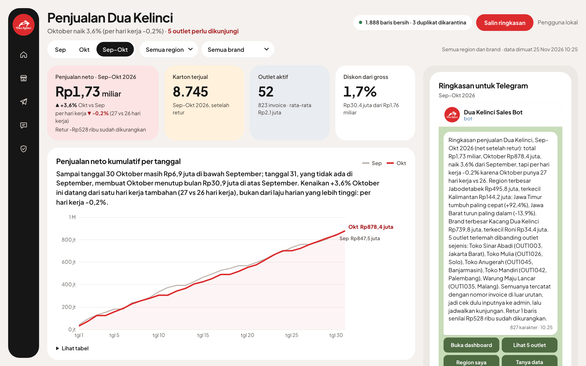
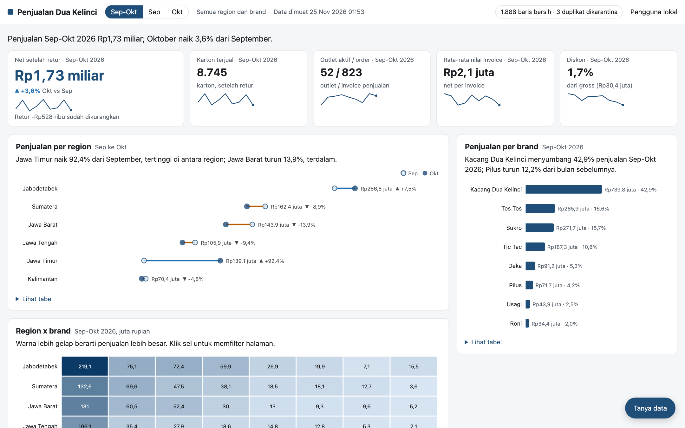
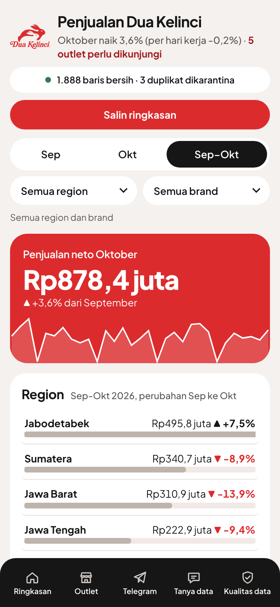
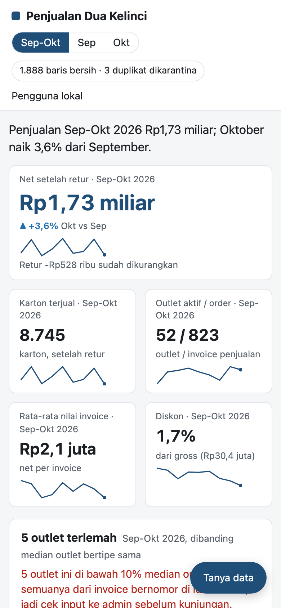

# 11 Tampilan untuk CEO dan Commercial Director

Tanggal: 27 November 2026. Branch `ceo-view`. Arah desain: [DESIGN.md](../DESIGN.md). Laporan Delivery Gate antislop: [11-ceo-view-antislop-gate.md](11-ceo-view-antislop-gate.md).

Pembacanya sekarang pemimpin komersial, bukan sales manager. Layar pertama harus bercerita dalam beberapa detik: berapa perubahan bulan ini, apakah perubahan itu nyata, dari mana asalnya, dan apa yang perlu diputuskan. Arahan Bagus: kurangi kata, fokus ke simbol, ikon, angka dan grafik; tanpa headline dan tanpa paragraf. UI sekarang berbahasa Inggris (keputusan Bagus); README dan dokumen tetap bahasa Indonesia.

## Sebelum dan sesudah

| Sebelum | Sesudah |
|---|---|
|  |  |
|  |  |

| Ukuran | Sebelum | Sesudah |
|---|---|---|
| Tinggi halaman desktop 1440 (screenshot penuh, skala 1,5) | 6.891 px, kira-kira 5 layar | 1.350 px, tepat 1 layar 1440x900 tanpa scroll |
| Kalimat di dashboard | headline, subjudul, 4 kalimat insight, saran per outlet | 0; label paling banyak 6 kata, penjelasan di balik ikon info |
| Ringkasan Telegram | 827 karakter, mulai dari total | 411 karakter, mulai dari insight; 10 angka dicek otomatis |
| JavaScript pihak ketiga | ECharts 1.034.102 byte | tidak ada; semua grafik SVG dari server |
| app.js + app.css | 42.350 byte | 35.204 byte |
| Warna | merah, hitam, 3 tint pastel | zinc + 1 aksen merah Dua Kelinci |

## Cerita yang dibaca layar pertama (dihitung dari data, tidak ditulis tangan)

- Net Oktober Rp 878.4M, naik Rp 30.9M (+3.6%) dari September. Per hari kerja turun 0.2% (27 vs 26 hari kerja).
- Satu outlet menjelaskan semuanya: Grosir Lancar Jaya (OUT1036, Grosir, Malang, Jawa Timur) naik dari Rp 28.3M ke Rp 76.0M (+Rp 47.7M; invoice 9 ke 18; karton 143 ke 415), 8.6% dari net Oktober. Tanpa outlet ini: Rp 819.2M ke Rp 802.5M, turun 2.0%.
- 4 dari 6 region turun: Jawa Barat −23.2, Sumatera −15.9, Jawa Tengah −11.0, Kalimantan −3.5; Jawa Timur +66.8 dan Jabodetabek +17.8 (Rp M).
- Brand: Pilus turun 12.2% (−Rp 4.7M), terdalam; Deka +13.9 dan Kacang Dua Kelinci +12.7 naik paling banyak.
- 5 outlet terlemah (syarat brief) semuanya kecil dan semuanya punya catatan nomor invoice di luar urutan.

Deteksinya umum, bukan khusus file ini: `analytics.story()` menghitung untuk file, akses, periode dan filter apa pun:

- outlet penyumbang terbesar = outlet yang bergerak paling jauh searah perubahan total (bisa lebih dari 100% perubahan total);
- pertumbuhan tanpa outlet itu;
- region turun N dari M, region dan brand yang turun paling dalam;
- jembatan (waterfall) per region dengan outlet teratas dipisah dari regionnya. Tes memastikan jumlah langkahnya sama persis dengan perubahan total, juga untuk filter region dan brand.

Contoh: login Head of Region Jawa Barat memperlihatkan cerita sebaliknya. Region turun 13.9%, outlet penyumbang terbesar Grosir Sentosa turun Rp 31.6M, dan tanpa outlet itu Jawa Barat justru naik 11.9%.

## 12 card, satu pertanyaan per card

1. Net sales Oct: angka, delta, grafik garis kumulatif harian Sep vs Oct dengan titik sorot di tanggal 31 (hari Oktober menyalip September) dan tooltip yang mengikuti mouse dan tombol panah.
2. Without top outlet: −2.0%, batang dengan dan tanpa outlet #1, tick meter porsi Grosir Lancar Jaya.
3. Per trading day: −0.2%, satu tick per tanggal (pendek = Minggu).
4. Regions down: 4/6 dan peta gelembung Indonesia bagian barat (luas = net Oktober, ▲▼ + Rp M). Garis pantai dari Natural Earth (domain publik), 3 KB, disimpan lokal.
5. Sep → Oct by region: jembatan per region.
6. Grosir Lancar Jaya: Rp 76.0M ×2.7, batang Sep vs Oct, invoice dan karton, "Check: sold through or stockpiled?".
7. Brand share: 42.8% Kacang Dua Kelinci (porsi Oktober; 42.9% adalah porsi Sep sampai Okt).
8. Brand movers: −12.2% Pilus, batang divergen di sekitar garis nol.
9. 5 weakest outlets: tick meter terhadap median tipe, ikon catatan data, unduh jadwal kunjungan (.ics) dan salin tugas.
10. Cartons Oct: 4,427 (+2.5%).
11. Data quality: 1,888 baris bersih, 3 karantina, 27 aturan.
12. Telegram: 10 angka dicek, satu-satunya tombol utama membuka laci ringkasan.

Heatmap region x brand dan baris "Perlu keputusan" dari rencana awal dilepas supaya semuanya muat dalam satu layar; keputusan yang sama sekarang dibawa card 6, 4/5 dan 8.

## Yang tetap

Dua perintah untuk menjalankan (pip install, python app.py), offline tanpa kunci. Aturan kualitas data, guardrail chat, mode production, login, telemetry tidak berubah. Chat offline tetap membaca dan menjawab dalam bahasa Indonesia karena mesinnya berbasis kata kunci bahasa Indonesia; label laci chat berbahasa Inggris dan menyebutkan hal ini. Pesan penolakan unggahan dari kontrak data juga masih bahasa Indonesia.

## Ikon, huruf, gerak

- Ikon Lucide (lisensi ISC) disalin lokal di `static/vendor/lucide/` dan disisipkan sebagai SVG. Catatan antislop R-04 (gaya ikon garis ala Lucide) diputuskan Bagus: tetap dipakai, dengan alasan relevansi per ikon di DESIGN.md.
- Satu keluarga huruf, Plus Jakarta Sans, termasuk teks di dalam SVG.
- Gerak: hanya hover, focus dan tooltip (MOTION 1). Dashboard adalah alat kerja harian; animasi masuk hanya menunda angka.

## Etalase: shot, animasi, GitHub Pages

- Shot 2x (`docs/img/shot-2x-1920x1600.png`, 348 KB): 1440x900 pada skala 2, dipotong 1920x1600 di tiga kolom pertama mulai dari baris card pertama. Di sana grafik paling padat: garis kumulatif dengan tooltip, pertumbuhan tanpa outlet teratas, tick hari kerja, jembatan region, kartu Grosir Lancar Jaya dan tick meter 5 outlet terlemah. Peta ada di kolom 4 dan 5, jadi tidak muat dalam satu potongan dengan jembatan. Dibuat oleh `scripts/showcase/shot.py`.
- Dua animasi (`scripts/showcase/motion.py`): "cards-stagger" (card muncul bergantian, 90 ms, naik 8 px) dan "isometric-lift" (dashboard dari bidang isometrik berdiri miring, lalu empat card cerita terangkat). GIF 1200 px 15 fps: 1,3 MB dan 4,1 MB di `docs/img/`; MP4 H.264: 0,2 MB dan 0,5 MB di `site/media/`. Frame dibuat deterministik: semua animasi dijeda lalu `currentTime` dimajukan per frame pada 30 fps.
- Animasi itu lapisan etalase saja. CSS dan JS-nya disuntikkan oleh skrip capture; aplikasinya tetap MOTION 1 (hanya hover, focus, tooltip) karena dashboard adalah alat kerja harian dan angka harus langsung terlihat.
- GitHub Pages (`.github/workflows/pages.yml`, dari `main`): halaman etalase di `site/`, shot, dua video (autoplay tanpa suara, berhenti dan tampil poster bila pengguna memilih reduced motion), dan snapshot statis dashboard yang diekspor dari aplikasi (`scripts/showcase/build_site.py`). Di snapshot, kontrol yang butuh server (periode, filter, chat, unggah, Telegram, cetak, .ics, CSV, tautan) dinonaktifkan atau menjadi teks biasa dan diberi label; laci, tooltip dan "Copy task" tetap jalan.

## Cara memeriksa

```
uv run pytest -q                       # 177 tes: unit, integrasi, e2e (Playwright)
uv run python scripts/ui_screenshots.py
```

Tes e2e memastikan 12 card muat di 1440x900 tanpa scroll, dan tidak ada elemen yang keluar dari card-nya di 1280x800, 1024x768 dan 390x844.
